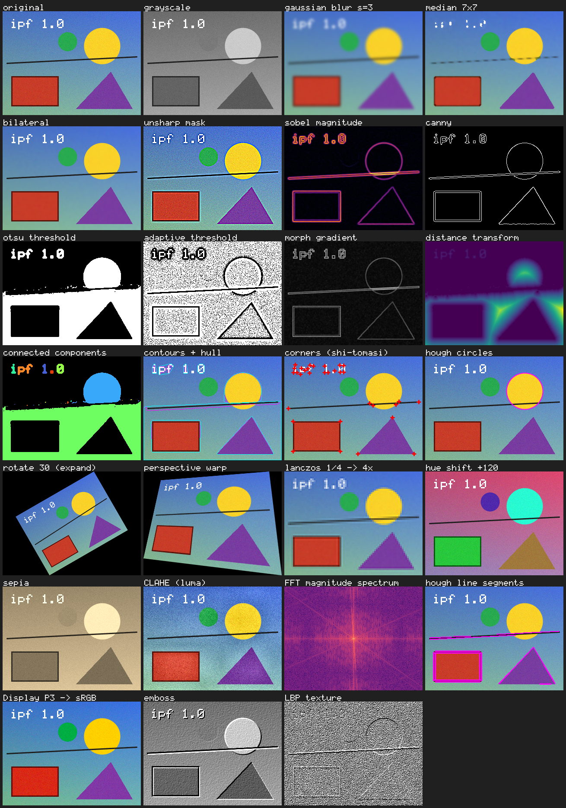

# ImageProcessingFlex (`ipf`)

[](LICENSE)


A **header-only, dependency-free C++17 image processing library**. Drop it into any
project and get image I/O (PNG/APNG, JPEG incl. 12-bit/lossless/arithmetic, BMP, TGA,
PNM, PFM) with metadata and ICC color management, color spaces, filtering, geometry,
morphology, FFT, feature detection, shape analysis, drawing and quality metrics — no
OpenCV, no libpng/libjpeg/zlib/littleCMS, no build step. Heavy algorithms use all CPU cores.

```cpp
#include <ipf/ipf.hpp>

int main() {
    ipf::ImageU8 img   = ipf::loadImage("photo.jpg", 3);                 // any format, upright, as RGB
    ipf::ImageU8 small = ipf::resize(img, img.width() / 2, img.height() / 2,
                                     ipf::Interpolation::Lanczos);       // antialiased
    ipf::ImageU8 edges = ipf::canny(ipf::rgbToGray(small), 50, 150);
    ipf::saveImage(edges, "edges.png");                                  // format from extension
}
```



## Contents

- [Installation](#installation)
- [Core concepts](#core-concepts)
- [Loading, saving and metadata](#loading-saving-and-metadata)
- [Feature overview](#feature-overview)
- [Examples](#examples)
- [How it is validated](#how-it-is-validated)
- [Performance](#performance)
- [Limitations](#limitations)
- [Building the tests](#building-the-tests)
- [License](#license)

## Installation

Pick whichever is easiest — all three give you the same library:

1. **Single file**: download
   [`single_include/ipf/ipf.hpp`](https://raw.githubusercontent.com/Veria70/ImageProcessingFlex/main/single_include/ipf/ipf.hpp)
   into your project and `#include "ipf.hpp"`.
2. **Header folder**: copy `include/ipf/` and add `include/` to your include path.
3. **CMake**:
   ```cmake
   include(FetchContent)
   FetchContent_Declare(ipf GIT_REPOSITORY https://github.com/Veria70/ImageProcessingFlex.git GIT_TAG main)
   FetchContent_MakeAvailable(ipf)
   target_link_libraries(my_app PRIVATE ipf::ipf)    # or add_subdirectory / find_package(ipf)
   ```
   `cmake --install` installs the headers plus an `ipfConfig.cmake` for `find_package(ipf)`.

Requirements: a C++17 compiler and the standard library (threads are used through
`std::thread`; define `IPF_NO_THREADS` for single-threaded platforms). Tested with MSVC 19.5x
(`/W4 /WX /permissive-`, C++17 and C++20, AddressSanitizer).

## Core concepts

```cpp
ipf::Image<T>   // T = uint8_t, uint16_t, int16_t, int32_t, float, double
ipf::ImageU8    ipf::ImageU16    ipf::ImageF    ipf::ImageD    ipf::ImageI32
```

- **Layout**: interleaved channels, row-major — `img(x, y, c)` is
  `data()[(y * width + x) * channels + c]`, the same as a numpy array of shape `(h, w, c)`.
- **Value semantics**: copying an `Image` copies its pixels. Functions return new images and
  never modify their inputs (drawing functions and `floodFill` are the in-place exceptions).
- **Value ranges**: integer images use their full range (0–255 for `uint8`), float images
  use `[0, 1]`. `toFloat`, `toU8` and `convertRange<U>` convert with rescaling;
  `convertTo<U>(scale, offset)` converts with saturation.
- **Channels**: 1 = gray, 2 = gray+alpha, 3 = RGB, 4 = RGBA. `convertChannels(img, n)`
  converts between them.
- **Rounding**: results are rounded to nearest and saturated to the output type
  (`saturate_cast`). Many filters accept an output type: `ipf::gaussianBlur<float>(img8, 2.0)`.
- **Borders**: `BorderMode::{Constant, Replicate, Reflect, Reflect101, Wrap}` (OpenCV names);
  filters default to `Reflect101`.
- **Coordinates**: `x` to the right, `y` down; for warps, pixel centers are at integer
  coordinates. Positive rotation angles are counter-clockwise as displayed.
- **Threads**: large operations run on all cores (`ipf::setNumThreads(n)`, `0` = all,
  `1` = serial). Work is split by rows, so **results are identical for any thread count**.
- **Errors**: invalid arguments, unreadable or corrupt files throw `ipf::Error`
  (derived from `std::runtime_error`). Decoders are fuzz-tested to throw, never crash.

```cpp
ipf::ImageU8 img(640, 480, 3, 0);              // black RGB image
img(10, 20, 0) = 255;                           // unchecked access
img.at(10, 20, 1) = 128;                        // bounds-checked access
ipf::ImageU8 roi = img.crop({100, 100, 64, 64});
img.paste(roi, 0, 0);
auto planes = ipf::splitChannels(img);          // std::vector<ImageU8>
auto ext = ipf::ImageF::fromData(w, h, 1, ptr); // wrap a buffer from another library (copies)
```

## Loading, saving and metadata

```cpp
// Photos come out upright: the EXIF orientation is applied by default.
ipf::ImageU8 img = ipf::loadImage("phone_photo.jpg");

// Read metadata and convert embedded color profiles (Adobe RGB, Display P3, CMYK, ...) to sRGB.
ipf::LoadOptions opt;
opt.convertToSRGB = true;
ipf::ImageMetadata meta;
ipf::ImageU8 srgb = ipf::loadImage("print.jpg", opt, &meta);
std::printf("%zu-byte ICC profile, %.0f dpi, %d-bit\n", meta.iccProfile.size(), meta.dpiX, meta.bitDepth);

// 16-bit precision is kept for 16-bit PNG/PNM and 12-bit / lossless JPEG.
ipf::ImageU16 deep = ipf::loadImage16("scan_12bit.jpg");

// Save with metadata (ICC profile, EXIF, DPI, text) and codec settings.
ipf::SaveOptions so;
so.quality = 92;
so.metadata = &meta;
ipf::saveImage(srgb, "out.jpg", so);

// Animated PNG
auto frames = ipf::loadAnimation("anim.png");   // composited RGBA frames + delays
ipf::saveAnimation(frames, "copy.png");
```

| Format | Read | Write |
|---|---|---|
| PNG / APNG | all color types, 1–16 bit, palette + tRNS, Adam7, animation (dispose/blend), iCCP, gAMA, sRGB, pHYs, tEXt/zTXt/iTXt, eXIf | 8/16-bit, automatic lossless palette / 1–4-bit gray, optional Adam7, metadata, APNG |
| JPEG | baseline, extended 12-bit, progressive, lossless (2–16 bit, all predictors), Huffman **and arithmetic** coding, restart markers, any subsampling, gray/YCbCr/RGB/CMYK/YCCK, EXIF, ICC, JFIF density, comments | baseline, quality 1–100, 4:2:0 / 4:4:4, ICC/EXIF/DPI/comment |
| BMP | 1/4/8-bit palette (incl. RLE4/RLE8), 16/24/32-bit, bitfields | 8-bit gray, 24-bit, 32-bit with alpha |
| TGA | color-mapped, true-color, gray; raw and RLE | raw or RLE |
| PGM/PPM/PBM | P1–P6, up to 16-bit | P2/P3/P5/P6, 8/16-bit |
| PFM | float gray/RGB | float gray/RGB |

## Feature overview

| Header | Highlights |
|---|---|
| `core.hpp` | `Image<T>`, `Point/PointF/Size/Rect`, `saturate_cast`, border handling, `copyMakeBorder`, channel split/merge/reorder, `minMaxLoc`, `mean`, `stddev`, `countNonZero` |
| `io.hpp` (+ `codec/`) | loading/saving with `LoadOptions`/`SaveOptions`/`ImageMetadata` (see above), `applyExifOrientation`, built-in zlib (`zlibCompress`/`zlibDecompress`, `crc32`, `adler32`) |
| `icc.hpp` | `IccProfile` (v2/v4: matrix/TRC, gray, `mft1`/`mft2`/`mAB`/`mBA` LUT profiles incl. CMYK), built-in `sRGB`, `displayP3`, `adobeRGB`, `linearSRGB`, `fromPrimaries`; `convertColorProfile` (perceptual / relative colorimetric / saturation) |
| `color.hpp` | `rgbToGray` (BT.601/709/average/lightness/max), HSV, HSL, YCbCr, XYZ, CIE Lab, `deltaE76`, `swapRB`, `adjustSaturation`, `shiftHue`, `sepia`, exact colormaps (`Viridis`, `Inferno`, `Magma`, `Plasma`, `Cividis`, `Turbo`, `Jet`, `Hot`, `Gray`) via `applyColormap` |
| `pixel_ops.hpp` | `add/subtract/multiply/divide/absDiff/addWeighted/blend`, `invert`, `brightnessContrast`, `alphaComposite`, `compare`, `inRange`, bitwise ops, `setTo`, `copyMasked`, `threshold` (5 types), `otsuThreshold`/`thresholdOtsu`, `histogram`, `applyLUT`, `gammaCorrect`, `normalize`, `autoContrast`, `equalizeHist`, `clahe`, `matchHistogram` |
| `filter.hpp` | `filter2D` (any kernel), `sepFilter2D`, `boxFilter`/`blur` (O(1)/pixel), `gaussianBlur`, `medianBlur` (O(k)/pixel for uint8), `bilateralFilter`, `sobel` (any order/size), `scharr`, `prewitt`, `laplacian`, `magnitude`, `phase`, `gradientMagnitude`, `unsharpMask`, `sharpen`, `emboss`, `motionBlurKernel`, `integralImage`, `adaptiveThreshold` |
| `fft.hpp` | `fft` (any length), `dft`/`idft` (2-D), `fftShift`, `magnitudeSpectrum`, `filter2DFFT` (same result as `filter2D`, fast for big kernels), `phaseCorrelate` (sub-pixel image registration) |
| `geometry.hpp` | `flipHorizontal/Vertical`, `transpose`, `rotate90`, `pad`, `resize` (Nearest, Bilinear, Bicubic, Lanczos, Area, Hamming — antialiased), `rescale`, `resizeToFit`, `sample`, `warpAffine`, `warpPerspective`, `remap`, `rotate` (optionally expanding the canvas), `getRotationMatrix2D`, `getAffineTransform`, `getPerspectiveTransform`, matrix inversion/composition, `pyrDown`, `pyrUp`, `buildPyramid` |
| `morphology.hpp` | `getStructuringElement` (rect/cross/ellipse), `erode`, `dilate`, `morphologyEx` (open, close, gradient, top-hat, black-hat), `hitOrMiss`, `thinning` (skeleton), `fillHoles`, `boundary` |
| `analysis.hpp` | `connectedComponents` (labels + area/bbox/centroid), `removeSmallObjects`, `largestComponent`, `findContours` (with hole/parent hierarchy), `contourArea`, `arcLength`, `boundingRect`, `convexHull`, `approxPolyDP`, `pointInPolygon`, `minEnclosingCircle`, `moments` (+ Hu invariants, orientation), `distanceTransform` (exact L2, L1, chessboard), `floodFill` |
| `features.hpp` | `canny`, `cannyAuto`, `cornerHarris`, `cornerMinEigenVal`, `goodFeaturesToTrack`, `findPeaks`, `houghLines`, `houghLinesP` (line segments), `houghCircles`, `matchTemplate` (6 methods, FFT-accelerated for large templates), `findTemplate`, `localBinaryPattern`, `iou`, `nmsBoxes` |
| `draw.hpp` | `drawLine` (thick, antialiased), `drawPolyline`, `fillPolygon`, `drawRectangle`, `drawCircle`, `drawEllipse`, `drawMarker`, `drawText` (built-in 5×8 font), `getTextSize` |
| `metrics.hpp` | `mse`, `mae`, `psnr`, `ssim` (+ SSIM map), `entropy`, `sharpness` (focus measure) |
| `parallel.hpp` | `setNumThreads`, `getNumThreads`, `parallelFor`, `parallelForN` (also usable for your own loops) |

`#include <ipf/ipf.hpp>` includes everything; each header can also be included on its own.

### Short recipes

```cpp
using namespace ipf;

// Denoise, segment and measure objects
ImageU8 gray = loadImage("cells.png", 1);
ImageU8 mask = thresholdOtsu(medianBlur(gray, 5));
mask = morphologyEx(mask, MorphOp::Open, getStructuringElement(MorphShape::Ellipse, 5));
Components cc = connectedComponents(fillHoles(mask));
for (const auto& s : cc.stats) std::printf("object %d: area %lld\n", s.label, s.area);

// Document-style perspective correction + binarization
Homography h = getPerspectiveTransform({PointF(52, 30), PointF(590, 64), PointF(610, 450), PointF(20, 420)},
                                       {PointF(0, 0), PointF(599, 0), PointF(599, 799), PointF(0, 799)});
ImageU8 page = warpPerspective(loadImage("doc.jpg", 1), h, Size(600, 800));
ImageU8 bin = adaptiveThreshold(page, 255, AdaptiveMethod::Gaussian, ThresholdType::Binary, 25, 10);

// Find a template and annotate it
MatchResult m = findTemplate(scene, logo);                 // normalized cross-correlation
drawRectangle(scene, Rect(m.location.x, m.location.y, logo.width(), logo.height()), Color(255, 0, 0), 2);
drawText(scene, "score " + std::to_string(m.score), m.location, Color(255, 255, 0), 2);

// Register two frames with sub-pixel accuracy
PhaseCorrelation pc = phaseCorrelate(rgbToGray(frame0), rgbToGray(frame1));
ImageU8 aligned = warpAffine(frame1, AffineMatrix{1, 0, -pc.shift.x, 0, 1, -pc.shift.y});

// Line segments of a drawing
for (const LineSegment& l : houghLinesP(canny(gray, 50, 150), 1, 3.14159265 / 180, 50, 30, 5))
    drawLine(scene, l.p0, l.p1, Color(0, 255, 0), 2);

// Local contrast enhancement on the luma channel only
ImageU8 ycc = rgbToYCbCr(photo);
insertChannel(ycc, clahe(extractChannel(ycc, 0), 3.0), 0);
ImageU8 enhanced = yCbCrToRgb(ycc);

// Convert a Display P3 image for an sRGB screen; compare two images
ImageU8 forWeb = convertColorProfile(photo, IccProfile::displayP3());
double quality = ssim(original, compressed);               // 1.0 = identical
```

## Examples

`examples/` contains runnable programs (built by CMake as `ipf_<name>`). Without arguments
they render a synthetic scene, so they run anywhere:

| Program | What it shows |
|---|---|
| `quickstart [image] [outdir]` | load → gray → blur → Canny → resize → Otsu → annotate → save |
| `gallery [image] [out.png]` | 27 algorithms on one image, rendered into a labelled contact sheet (above) |
| `count_objects [image] [out.png]` | segmentation, morphology cleanup, labeling, contours, measurements |
| `benchmark [w] [h]` | timings of common operations with 1 thread and with all threads |

## How it is validated

Every module is checked three ways:

1. **Unit tests** (`tests/test_*.cpp`, 80 tests / ~3,900 checks): analytic expectations
   (impulse responses, gradients of ramps, Laplacian of quadratics, exact moments,
   distance transforms vs brute force, FFT vs a naive DFT, contour hierarchies, Lab and ICC
   reference values, CRC/Adler vectors, codec and metadata round trips), reference JPEGs made by
   libjpeg-turbo (12-bit arithmetic progressive, 16-bit lossless, ...) stored in `tests/data`,
   **thread-count independence** (18 operations bit-identical with 1 and 8 threads), API misuse,
   and **fuzz tests** feeding ~4,000 truncated/corrupted files and ICC profiles to the parsers.
   The suite runs under **AddressSanitizer**, in C++20 mode, and every header compiles standalone.
2. **Cross-validation** (`tests/crossval/`, 487 checks) against independent implementations:
   - **libjpeg-turbo 3.1** (`cjpeg`/`djpeg`/`jpegtran` built from source): official test images,
     8/12-bit baseline/progressive/arithmetic/progressive-arithmetic, restart intervals,
     subsampling modes, and 112 lossless variants (2/8/12/16-bit × 7 predictors × point
     transforms × gray/RGB) — lossless results are bit-exact, DCT results within ±2 levels.
   - **littleCMS 2** (via Pillow): matrix/TRC (curv gamma, sampled, parametric), gray, v4
     lutAtoB, lut8 and the CMYK lut16 printer profile from libjpeg-turbo, both directions and
     end-to-end (CMYK JPEG with embedded profile) — all within 1 level.
   - **Pillow**: PNG (all modes, palette + tRNS, 16-bit, metadata chunks, APNG with every
     dispose/blend mode), JPEG, BMP, TGA, PNM, EXIF orientation (all 8), `resize` for all six
     filters, grayscale, YCbCr, saturation, autocontrast; Pillow also decodes ipf's outputs.
   - **zlib**, **scipy.ndimage** (filters in all border modes, morphology, labeling, distance
     transforms, warps), **numpy** (FFT, template matching, moments, SSIM, color conversions)
     and **matplotlib's** colormap tables (bit-exact).
3. **Visual checks** of the gallery and object-counting outputs.

## Performance

1920×1080 RGB image, MSVC `/O2`, 32 hardware threads (`examples/benchmark.cpp`):

| Operation | 1 thread | all threads |
|---|---:|---:|
| JPEG decode / encode q90 | 34 / 33 ms | 22 / 33 ms |
| PNG decode | 46 ms | 45 ms |
| Gaussian blur σ=2 (RGB) | 33 ms | 7.5 ms |
| median 5×5 (gray) | 25 ms | 3.0 ms |
| bilateral d=9 (gray) | 271 ms | 62 ms |
| resize ½ Lanczos (RGB) | 21 ms | 6.9 ms |
| rotate 15° bilinear (RGB) | 56 ms | 5.6 ms |
| exact distance transform | 24 ms | 6.7 ms |
| Adobe RGB → sRGB (ICC) | 202 ms | 15 ms |
| template matching, 128×96 template (FFT) | 388 ms | 76 ms |
| Canny (gray) | 24 ms | 21 ms |

PNG encoding (deflate) is single-threaded and comparable to zlib; use `PngOptions::level = 1`
for fast saves.

## Limitations

- JPEG: hierarchical (SOF5–7, 13–15) and lossless arithmetic-coded (SOF11) files are not
  supported — no common encoder writes them and libjpeg-turbo rejects them too. The encoder
  writes baseline JPEG only.
- ICC: no black point compensation, absolute colorimetric is treated as relative, and
  named-color / device-link / abstract profiles are not supported.
- Deflate compression (PNG saving) and JPEG encoding run on one thread.
- No platform-specific SIMD intrinsics: hot loops are written for compiler auto-vectorization
  (verified with MSVC's vectorizer report) and run in parallel instead.

## Building the tests

```bash
cmake -S . -B build -DCMAKE_BUILD_TYPE=Release
cmake --build build
ctest --test-dir build                       # unit tests

# optional: cross-validation (needs Python 3 with numpy, scipy, Pillow; the JPEG reference
# section additionally uses libjpeg-turbo tools: set IPF_LJT_BIN / IPF_LJT_TESTIMAGES)
cmake -S . -B build -DIPF_CROSSVAL=ON && cmake --build build && ctest --test-dir build
python tests/crossval/run_crossval.py build/tests/ipf_crossval [section ...]

# optional: AddressSanitizer build
cmake -S . -B build-asan -DIPF_SANITIZE=ON -DCMAKE_BUILD_TYPE=Debug
```

On Windows without CMake on `PATH`, `tools/build.sh [Release|Debug] [17|20] [asan]` builds
with Visual Studio's bundled CMake/Ninja and runs the tests. Regenerate the single header
with `python tools/amalgamate.py` after editing `include/`.

## License

ImageProcessingFlex is released under the [MIT License](LICENSE) — free for commercial and
open-source use; keep the copyright notice. Bundled third-party data (the Turbo colormap under
Apache-2.0, CC0 matplotlib colormaps) and acknowledgements (the JPEG decoder is based in part on
the work of the Independent JPEG Group) are listed in [THIRD_PARTY_NOTICES.md](THIRD_PARTY_NOTICES.md).
